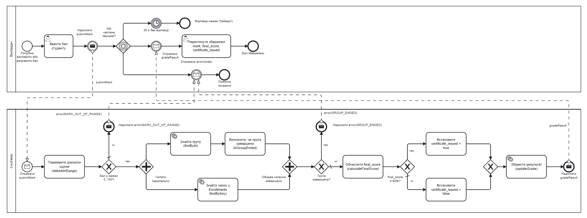

## Домен: Онлайн платформа з різними курсами по програмуванню.

### Намір

Описати бізнес-процес виставлення або виправлення бала студенту (UC-5 "Виставити або виправити бали") у нотації BPMN 2.0: хто виконує кожен крок, де процес розгалужується, якими повідомленнями обмінюються учасники та чим процес завершується.

## Процес UC-5 "Виставити або виправити бали"

Процес починається, коли викладачу потрібно виставити новий бал або виправити наявний. Система завершує обробку одним із трьох результатів:

- бал збережено, викладачу надсилається `gradeResult`;
- бал відхилено, викладачу надсилається `error(MARK_OUT_OF_RANGE)`;
- бал відхилено, викладачу надсилається `error(GROUP_ENDED)`.

У пулі "Викладач" три кінцеві події: "Бал збережено", "Помилку показано" (для обох помилок) і "Відповіді немає (таймаут)".

### Діаграма:

- Рендер (Джерело: BPMN 2.0 XML):

### Ролі (пули):

- **Викладач** - вводить бал, надсилає запит і очікує відповідь системи;
- **Система** - перевіряє бал і дату завершення групи, обчислює `final_score`, визначає `certificate_issued`, зберігає результат і повертає відповідь викладачу.

### Передумови:

- Існує запис студента в навчальній групі (Enrollments);
- Викладач авторизований і є викладачем курсу, до якого належить група `(Courses.teacher_id)`, відповідно до NFR-004;
- Викладач уже переглянув поточні результати студента (UC-6).

## Кроки

### Пул "Викладач"

1. Стартова подія "Потрібно виставити або виправити бал"
2. Користувацька задача "Ввести бал студенту"
3. Проміжна подія "Надіслати submitMark"
4. Шлюз на основі подій "Що настане першим?":
   - "Отримано gradeResult" -> задача "Переглянути збережені mark, final_score, certificate_issued" -> "Бал збережено";
   - "Отримано error(code)" -> "Помилку показано";
   - таймер "30 с без відповіді" -> "Відповіді немає (таймаут)".

### Пул "Система"

1. Стартова подія "Отримано submitMark"
2. Задача "Перевірити діапазон оцінки (isMarkInRange)"
3. Шлюз XOR "Бал у межах 0..100?":
   - ні -> "Надіслати error(MARK_OUT_OF_RANGE)";
   - так -> продовження.
4. Паралельний шлюз "Читати паралельно":
   - "Знайти групу (findById)" -> "Визначити, чи група завершена (isGroupEnded)";
   - "Знайти запис у Enrollments (findByKey)".
5. Паралельний шлюз "Обидва читання завершено"
6. Шлюз XOR "Група завершена?":
   - так -> "Надіслати error(GROUP_ENDED)";
   - ні -> продовження.
7. Задача "Обчислити final_score (calculateFinalScore)"
8. Шлюз XOR "final_score >= 60%?":
   - так -> "Встановити certificate_issued = true";
   - ні -> "Встановити certificate_issued = false".
9. Шлюз XOR об'єднує гілки
10. Сервісна задача "Зберегти результат (updateGrade)"
11. Кінцева подія "Надіслати gradeResult"

## Розгалуження

| Шлюз                                         | Тип         | Умова                                     | Гілка за замовчуванням            | Вимога           |
| -------------------------------------------- | ----------- | ----------------------------------------- | --------------------------------- | ---------------- |
| Бал у межах 0..100?                          | XOR         | `mark >= 0 && mark <= 100`                | ні (`MARK_OUT_OF_RANGE`)          | REQ-014          |
| Читати паралельно / Обидва читання завершено | AND         | -                                         | -                                 | -                |
| Група завершена?                             | XOR         | поточна дата пізніша за `Groups.end_date` | ні (продовжити)                   | REQ-008          |
| final_score >= 60%?                          | XOR         | `final_score >= 60`                       | ні (`certificate_issued = false`) | REQ-004, REQ-012 |
| Що настане першим?                           | event-based | перша з подій: gradeResult, error, таймер | -                                 | -                |

Обчислення `final_score` відповідає REQ-013.

## Повідомлення

Між пулами чотири потоки повідомлень трьох типів: `submitMark`, `gradeResult` і `error`.

| Потік повідомлення         | Тип           | Від      | До       | Зміст                                       | Відповідник у Sequence (lab3)   | Якщо відповіді немає             |
| -------------------------- | ------------- | -------- | -------- | ------------------------------------------- | ------------------------------- | -------------------------------- |
| `submitMark`               | `submitMark`  | Викладач | Система  | `student_id`, `group_id`, `mark`            | `submitMark` і `updateMark`     | таймаут через 30 с               |
| `gradeResult`              | `gradeResult` | Система  | Викладач | `mark`, `final_score`, `certificate_issued` | `gradeResult` у S1–S4           | таймаут; бал міг бути збережений |
| `error(MARK_OUT_OF_RANGE)` | `error`       | Система  | Викладач | код помилки                                 | `error(MARK_OUT_OF_RANGE)` у S5 | таймаут; бал не збережено        |
| `error(GROUP_ENDED)`       | `error`       | Система  | Викладач | код помилки                                 | `error(GROUP_ENDED)` у S6       | таймаут; бал не збережено        |

## Відповідність сценаріям

| Сценарій (lab2 / lab3) | Шлях у BPMN                                                                                            |
| ---------------------- | ------------------------------------------------------------------------------------------------------ |
| S1, S2                 | діапазон так -> читання -> група не завершена -> `final_score >= 60%` так -> збереження -> gradeResult |
| S3, S4                 | діапазон так -> читання -> група не завершена -> `final_score >= 60%` ні -> збереження -> gradeResult  |
| S5                     | діапазон ні -> error(MARK_OUT_OF_RANGE)                                                                |
| S6                     | діапазон так -> читання -> група завершена -> error(GROUP_ENDED)                                       |
| S7, S8 (UC-6)          | поза процесом (передумова)                                                                             |

## Обґрунтування вибору BPMN

- Машина станів описує життєвий цикл однієї сутності, а в UC-5 головне - обмін повідомленнями між Викладачем і Системою;
- Діаграма діяльності показує кроки й розгалуження, але не має потоків повідомлень між пулами та шлюзу на основі подій з таймером;
- BPMN має і те, і інше, а також показує всі сценарії S1–S6 одним процесом, тоді як Sequence-діаграми lab3 описують кожен сценарій окремо.

## Додаткові уточнення:

- Чотири системні учасники Sequence (`GradeController`, `GradeService`, `Enrollments`, `Groups`) об'єднано в пул "Система", бо це частини однієї системи, а не окремі сторони процесу;
- На use-case діаграмі lab2 UC-6 включається в UC-5 через `<<include>>`, а в BPMN він записаний передумовою. Перегляд результатів відбувається до виставлення бала і не впливає на жодне розгалуження;
- Читання групи і запису Enrollments не залежать одне від одного, тому виконуються паралельно. У Sequence lab3 вони послідовні, і в S6 запис не читається, а в BPMN він читається навіть тоді, коли група завершена, і на результат це не впливає;
- Внутрішні виклики Sequence (`findById`, `findByKey`, `updateGrade` тощо) показані задачами в пулі "Система", а не повідомленнями.

### Поза обсягом:

- UC-6 "Переглянути поточні результати студента" - див. "Додаткові уточнення", 2;
- Перевірка прав викладача (NFR-004) записана передумовою, як і в lab3 (ADR 0002 lab3), бо випадку з чужим курсом немає в жодному сценарії;
- Повідомлення про перевищення часу очікування в черзі з NFR-002, бо це поведінка під навантаженням, а не крок процесу, і сценарію для неї немає;
- Видача сертифіката та email-сповіщення, бо процес закінчується збереженням результату, а в моделі lab1 немає сутностей для сертифіката чи сповіщень.
