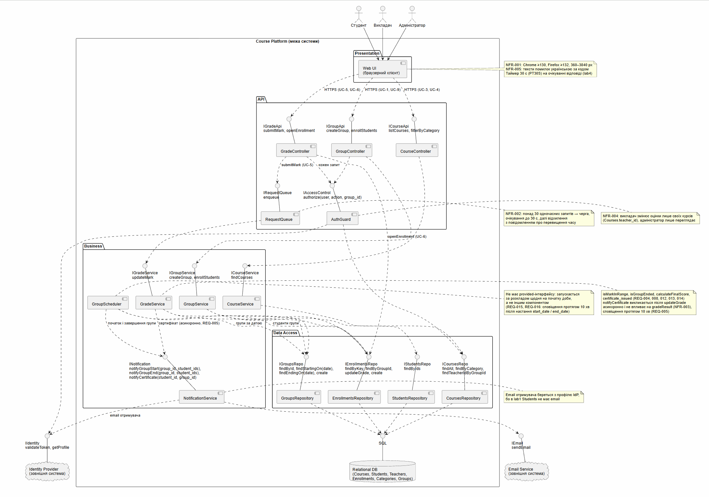

## Домен: Онлайн платформа з різними курсами по програмуванню.

### Намір

Показати, з чого складається платформа: які в неї модулі, як вони спілкуються через інтерфейси і де закінчується система. Діаграма охоплює всю платформу, а ланцюг UC-5 / UC-6 простежується аж до sequence-діаграм lab3 і BPMN lab4.

### Діаграма:

- Джерело (PlantUML): [component-diagram.puml](./component-diagram/component-diagram.puml)
- Рендер:

### Межа системи:

Усередині "Course Platform" живуть Web UI, контролери, сервіси, репозиторії та БД. Зовні лишаються актори (Студент, Викладач, Адміністратор) і дві зовнішні системи: Identity Provider та Email Service. Актори заходять у систему лише через Web UI, а сама система виходить назовні лише через `IIdentity` та `IEmail`.

### Модулі:

| Шар          | Компоненти                                                                     | Що роблять                                                                                  |
| ------------ | ------------------------------------------------------------------------------ | ------------------------------------------------------------------------------------------- |
| Presentation | Web UI                                                                         | Інтерфейс для всіх акторів, показує результати й помилки, чекає відповідь 30 с              |
| API          | CourseController, GroupController, GradeController                             | Приймають запити для курсів (UC-3, UC-4), груп (UC-1, UC-9) і оцінок (UC-5, UC-6)           |
| API          | AuthGuard, RequestQueue                                                        | Перевіряє права (NFR-004) і ставить запити на оцінку в чергу (NFR-002)                      |
| Business     | CourseService, GroupService, GradeService                                      | Логіка курсів, груп і оцінювання (діапазон, дата групи, `final_score`, сертифікат)          |
| Business     | NotificationService, GroupScheduler                                            | Надсилають сповіщення: про сертифікат після оцінки, про початок і завершення групи за датою |
| Data Access  | CoursesRepository, GroupsRepository, EnrollmentsRepository, StudentsRepository | Читають і записують сутності lab1                                                           |
| БД           | Relational DB                                                                  | Зберігає Courses, Students, Teachers, Enrollments, Categories, Groups                       |

### Інтерфейси:

| Інтерфейс          | Хто надає             | Хто використовує                                            | Операції                                                  |
| ------------------ | --------------------- | ----------------------------------------------------------- | --------------------------------------------------------- |
| `ICourseApi`       | CourseController      | Web UI                                                      | `listCourses`, `filterByCategory`                         |
| `IGroupApi`        | GroupController       | Web UI                                                      | `createGroup`, `enrollStudents`                           |
| `IGradeApi`        | GradeController       | Web UI                                                      | `submitMark`, `openEnrollment`                            |
| `IAccessControl`   | AuthGuard             | GradeController, GroupController                            | `authorize(user, action, group_id)`                       |
| `IRequestQueue`    | RequestQueue          | GradeController                                             | `enqueue`                                                 |
| `ICourseService`   | CourseService         | CourseController                                            | `findCourses`                                             |
| `IGroupService`    | GroupService          | GroupController                                             | `createGroup`, `enrollStudents`                           |
| `IGradeService`    | GradeService          | RequestQueue                                                | `updateMark`                                              |
| `INotification`    | NotificationService   | GradeService, GroupScheduler                                | `notifyGroupStart`, `notifyGroupEnd`, `notifyCertificate` |
| `ICoursesRepo`     | CoursesRepository     | CourseService, AuthGuard                                    | `findAll`, `findByCategory`, `findTeacherIdByGroupId`     |
| `IGroupsRepo`      | GroupsRepository      | GradeService, GroupService, GroupScheduler                  | `findById`, `findStartingOn`, `findEndingOn`, `create`    |
| `IEnrollmentsRepo` | EnrollmentsRepository | GradeController, GradeService, GroupService, GroupScheduler | `findByKey`, `findByGroupId`, `updateGrade`, `create`     |
| `IStudentsRepo`    | StudentsRepository    | GroupService                                                | `findByIds`                                               |
| `IIdentity`        | Identity Provider     | AuthGuard, NotificationService                              | `validateToken`, `getProfile`                             |
| `IEmail`           | Email Service         | NotificationService                                         | `sendEmail`                                               |

### Зовнішні інтеграції:

- **Identity Provider** перевіряє токен для AuthGuard і віддає профіль з email для NotificationService (NFR-004);
- **Email Service** надсилає листи. Це та сама служба email-сповіщень з lab2, яка не стала актором, бо сама нічого не починає (REQ-005, REQ-015, REQ-016).

### Як проходить запит:

- **UC-3, UC-4:** Web UI -> CourseController -> CourseService -> CoursesRepository -> БД;
- **UC-1, UC-9:** Web UI -> GroupController -> AuthGuard (роль адміністратора) -> GroupService -> GroupsRepository, StudentsRepository, EnrollmentsRepository -> БД;
- **UC-5:** Web UI -> GradeController -> AuthGuard -> RequestQueue -> GradeService -> GroupsRepository і EnrollmentsRepository -> БД, а вже після збереження GradeService асинхронно просить NotificationService надіслати лист про сертифікат;
- **UC-6:** Web UI -> GradeController -> AuthGuard -> EnrollmentsRepository -> БД;
- **Сповіщення про групу:** GroupScheduler -> GroupsRepository (хто починається чи завершується сьогодні) -> EnrollmentsRepository (хто в групі) -> NotificationService -> IdP (email) -> Email Service.

### Трасування до попередніх моделей:

"н/з" означає "не застосовується", тобто цей компонент у попередній моделі не деталізувався, і причина описана в дужках.

| Компонент                       | lab1 (дані)                   | lab2 (вимоги)                | lab3 (взаємодія)                             | lab4 (процес)                               |
| ------------------------------- | ----------------------------- | ---------------------------- | -------------------------------------------- | ------------------------------------------- |
| Web UI                          | н/з (не зберігає дані)        | актори; NFR-001, NFR-005     | н/з (Викладач іде одразу до GradeController) | пул "Викладач", таймер 30 с                 |
| CourseController, CourseService | Courses, Categories           | UC-3, UC-4; REQ-010, REQ-011 | н/з (UC-3, UC-4 не деталізовані)             | н/з (UC-3, UC-4 не деталізовані)            |
| GroupController, GroupService   | Groups, Enrollments, Students | UC-1, UC-9; REQ-006, REQ-007 | н/з (UC-1, UC-9 не деталізовані)             | н/з (UC-1, UC-9 не деталізовані)            |
| GradeController                 | Enrollments                   | UC-5, UC-6; REQ-014, REQ-017 | GradeController (S1–S8)                      | потоки `submitMark`, `gradeResult`, `error` |
| AuthGuard                       | Courses.teacher_id            | NFR-004                      | н/з (передумова, ADR 0002 lab3)              | н/з (передумова)                            |
| RequestQueue                    | н/з                           | NFR-002                      | н/з (черги немає)                            | н/з (є лише таймер у Викладача)             |
| GradeService                    | Enrollments, Groups           | REQ-004, 008, 012, 013, 014  | GradeService (S1–S6)                         | задачі й XOR-шлюзи пулу "Система"           |
| NotificationService             | н/з (email з IdP)             | REQ-005, REQ-015, REQ-016    | н/з (кроку сповіщення немає)                 | н/з ("Поза обсягом" lab4)                   |
| GroupScheduler                  | Groups.start_date, end_date   | REQ-015, REQ-016             | н/з (кроку сповіщення немає)                 | н/з ("Поза обсягом" lab4)                   |
| CoursesRepository               | Courses, Categories           | UC-3, UC-4; NFR-004          | н/з (Courses лише в передумові)              | н/з (Courses лише в передумові)             |
| GroupsRepository                | Groups                        | UC-5, UC-9                   | Groups (`findById`)                          | "Знайти групу (findById)"                   |
| EnrollmentsRepository           | Enrollments                   | UC-1, UC-5, UC-6             | Enrollments (`findByKey`, `updateGrade`)     | "Знайти запис", "Зберегти результат"        |
| StudentsRepository              | Students                      | UC-1                         | н/з (student_id лише в ключі)                | н/з                                         |
| Relational DB                   | усі сутності                  | -                            | -                                            | -                                           |
| Identity Provider               | н/з                           | NFR-004                      | н/з (передумова авторизації)                 | н/з (передумова авторизації)                |
| Email Service                   | н/з                           | REQ-005, REQ-015, REQ-016    | н/з                                          | н/з ("Поза обсягом" lab4)                   |

## Додаткові уточнення:

- Операції ланцюга UC-5 / UC-6 названі так само, як повідомлення в sequence-діаграмах lab3: `submitMark` і `openEnrollment` приходять до GradeController, `updateMark` іде до GradeService, а `findById`, `findByKey` і `updateGrade` - це звернення до Groups та Enrollments. Ті самі звернення є задачами в пулі "Система" BPMN lab4;
- GroupScheduler не має provided-інтерфейсу, бо його ніхто не викликає: він сам запускається за розкладом щодня на початку доби. Дати груп у lab1 мають тип `date` без часу, тож такий запуск вкладається в 10 хвилин з REQ-015 і REQ-016;
- Для `createGroup` групи ще не існує, тому `authorize` перевіряє лише роль адміністратора без `group_id`. CourseController перевірки прав не має, бо каталог курсів (UC-3) на use-case діаграмі доступний будь-якому користувачу;
- Email отримувача NotificationService бере з профілю Identity Provider (`getProfile`), бо в моделі lab1 у Students є лише `id`, `first_name` і `last_name`. Припускається, що студента з `Students.id` зіставляє з користувачем сам IdP;
- Лист про сертифікат надсилається асинхронно і лише після `updateGrade`. Таким чином він не затримує `gradeResult` (NFR-003), а REQ-005 і так дає на сповіщення 10 хвилин;
- Лист про завершення групи йде в день `end_date`, як вимагає REQ-016, але за S6 lab3 група вважається завершеною лише наступного дня, тож у день `end_date` студент уже отримав лист, а викладач ще може змінювати оцінки;
- Categories і Teachers не мають своїх репозиторіїв. Зв'язок n to n між Courses і Categories обробляє CoursesRepository (`findByCategory`), а Teachers потрібен лише через `Courses.teacher_id` (`findTeacherIdByGroupId`);
- Тексти REQ-005, REQ-006, REQ-007, REQ-015 і REQ-016 наведено в попередній версії lab2. У поточній lab2 вони перелічені в spec.md і матриці трасування як вимоги, що не включені до набору EARS, бо не описують поведінку UC-5, але як вимоги до платформи вони залишаються;
- NFR, як і в lab2, не включено до матриці трасування, тому вони зіставлені з компонентами тут: NFR-001 і NFR-005 реалізує Web UI, NFR-002 - RequestQueue разом із таймером 30 с у Web UI, NFR-003 - GradeController, GradeService і репозиторії, через які проходить запит (асинхронне сповіщення про сертифікат лише не затримує відповідь), NFR-004 - AuthGuard, Identity Provider і CoursesRepository.

### Поза обсягом:

- **Платіжний шлюз**
  Його було видалено ще в lab2 разом із REQ-009 (ADR 0001 lab2), оскільки у моделі lab1 немає ні ціни групи, ні статусу оплати, а в бізнес-правилах ніде не сказано, що курси платні. Тому серед зовнішніх інтеграцій його немає, хоча в завданні Payment наведено як приклад;
- **Заявки студентів на зарахування**
  У моделі lab1 немає для них сутності, і в lab2 вони теж поза обсягом. Тому студентів до групи зараховує адміністратор (UC-1), а окремого компонента для заявок немає;
- **SMS-сповіщення та інші провайдери входу (OAuth)**
  На них немає жодної вимоги в lab2. Email Service покриває всі сповіщення з REQ-005, REQ-015 і REQ-016, а Identity Provider - автентифікацію;
- **Детальні потоки UC-1, UC-3, UC-4 і UC-9**
  У lab3 і lab4 деталізовано лише UC-5 і UC-6. Тому компоненти для цих UC трасуються лише до lab1 і lab2, а в стовпцях lab3 і lab4 позначено "н/з", як і непокриті зв'язки в матриці lab2;
- **Сценарій для Адміністратора в UC-6**
  Адміністратор має доступ до UC-6 на use-case діаграмі, а AuthGuard дозволяє йому лише перегляд за NFR-004. Проте окремого сценарію для нього немає ні в lab2, ні в lab3, тому діаграма не показує для нього окремого потоку;
- **Повідомлення про перевищення часу очікування в черзі**
  RequestQueue на діаграмі є, але саме повідомлення про відхилення запиту з NFR-002 не має сценарію в lab2–lab4, тому окремого інтерфейсу для нього немає;
- **Гілки "групу або запис не знайдено"**
  Існування запису є передумовою UC-5, тому окремої обробки цього випадку в компонентах немає;
- **Розгортання (deployment)**
  Сервери, контейнери, мережа та масштабування не входять до компонентної моделі й описуються іншою діаграмою.

### Критерії прийняття:

- Діаграма описана в PlantUML, і рендер збігається з кодом;
- На діаграмі є всі шари (UI, API, сервіси, Data Access, БД), а межа системи відділяє їх від акторів і зовнішніх систем;
- Кожен компонент має provided-інтерфейс або пояснення, чому його немає, а кожна залежність іде через required-інтерфейс;
- Зовнішні інтеграції показані як зовнішні системи, а не як актори;
- Кожен компонент має рядок у трасуванні, і в кожній клітинці є відповідник у lab1–lab4 або "н/з" з причиною;
- Операції ланцюга UC-5 / UC-6 збігаються з повідомленнями lab3 і задачами BPMN lab4;
- Кожна NFR зіставлена з компонентами, які її реалізують.
